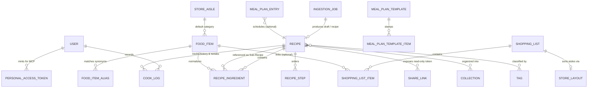
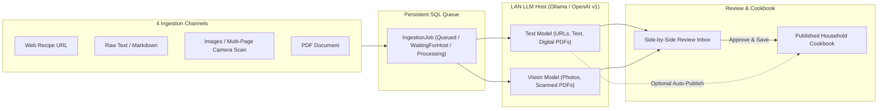
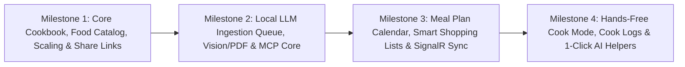

# Product Requirements Document (PRD): LocalRoast

**LocalRoast** is a self-hosted household recipe vault, local-AI multimodal recipe ingestion engine, meal planning calendar, and real-time shopping list application. Capture recipes from URLs, cookbook photos, PDFs, or chat assistants via a local LLM (`Ollama` or OpenAI-compatible server) and an embedded Model Context Protocol (**MCP**) server; plan real-world weeks of meals; shop together with live-synced aisle-sorted grocery lists; and cook hands-free in the kitchen.

> [!NOTE]
> **Document Scope:** This PRD defines the functional requirements, domain model, user workflows, and phased roadmap for **LocalRoast**—built on `.NET 10`, `Entity Framework Core 10` (SQL Server), and `Angular 22` (Material 3) for self-hosted Docker / TrueNAS Scale deployment.

---

## 1. Executive Summary & Product Vision

**LocalRoast** solves four everyday household kitchen frustrations:

1. **Recipe Sprawl & Link Rot:** Great recipes get buried across ad-heavy food blogs, phone screenshots, PDF printouts, family text messages, and physical cookbooks—and bookmarked URLs eventually disappear or change.
2. **Manual Data-Entry Fatigue:** Typing 18 ingredients and 9 steps by hand stops people from centralizing their recipes. LocalRoast delegates extraction, normalization, timer detection, and aisle classification to a local LLM on your LAN while preserving a Side-by-Side Review Inbox for accuracy.
3. **Rigid Meal Calendars:** Most meal planners assume every single meal is a newly cooked recipe on a fixed night. Real households cook multi-dish dinners, eat leftovers on Wednesday, order takeout on Friday, and often buy groceries for four dinners on Saturday without deciding *which* night to cook each one until 5:00 PM.
4. **Cluttered Grocery Runs & Messy-Hand Cooking:** Shopping lists shouldn't list `"water"` and `"kosher salt"` every week or get out of sync when two people split up in the grocery store—and phones shouldn't dim or force endless up-and-down scrolling while your hands are covered in dough.

### Core Product Pillars
1. **Local-First Multimodal Ingestion & MCP Native:** Turn Web URLs, raw text, multi-page cookbook photos, and PDFs into structured recipes via `Ollama` (or any OpenAI-compatible `/v1` host) with offline-queue resilience—and expose your cookbook, meal calendar, and shopping lists to external AI clients through an embedded `/api/mcp` server.
2. **Canonical Food Catalog & Culinary Math:** Structured quantities, ranges, units, and section headers backed by a shared `FoodItem` dictionary (with default grocery aisles, aliases, and pantry-staple flags) enable accurate scaling, US/Metric conversion, and consolidated shopping lists.
3. **Flexible Real-World Meal Planning:** Combine `Breakfast`, `Lunch`, `Dinner`, and `Snack / Prep` calendar slots with multi-dish support, `Leftovers` entries, freeform notes, an **"On-Deck" flexible weekly tray**, and reusable **Week Templates**.
4. **Hands-Free Kitchen & Live Co-Shopping:** Screen wake-lock **Cook Mode** with inline step ingredient callouts and floating multi-timers, historical **Cook Logs**, and **SignalR** real-time co-shopping sorted by custom store aisle layouts.

---

## 2. Target Users, Tenancy & Operating Context

| Persona / Actor | Primary Surfaces | Key Workflows |
| :--- | :--- | :--- |
| **Household Cooks & Planners** | **Desktop Browser**, **Tablet**, & **Mobile Phone** | Ingesting & reviewing recipes, curating collections, planning weekly meals, generating shopping lists, cooking in Cook Mode, and logging cook notes/ratings. |
| **Household Co-Shoppers** | **Mobile Phone (In-Store)** | Checking off grocery items in real time across multiple phones, adding ad-hoc household items, and walking aisles in store-specific order. |
| **External Friends & Family** | **Public Browser (No Login)** | Viewing, scaling, and printing a single shared recipe via a revocable `/share/<token>` link. |
| **External AI Assistants (MCP Clients)** | **Claude Desktop, Antigravity, Open WebUI, Voice Agents** | Searching the household cookbook, pushing or enqueueing new recipes, drafting weekly meal plans, and updating shopping lists over `/api/mcp`. |

### Tenancy & Operating Assumptions
- **Single Global Household per Instance:** Every authenticated user on the server automatically collaborates on one shared household cookbook, food catalog, ingestion inbox, meal calendar, and set of shopping lists—with zero workspace-switching ceremony. Entity auditing (`IAuditable`) and domain logs preserve per-user attribution (*Added by*, *Cooked by*, *Checked off by*).
- **TrueNAS Scale / Homelab HTTPS Environment:** LocalRoast runs as a unified container (`62781:8080`) behind a local HTTPS reverse proxy (e.g., Nginx Proxy Manager / Caddy / Traefik), unlocking browser `navigator.mediaDevices` (mobile camera cookbook scans) and `navigator.wakeLock` (screen stay-awake in Cook Mode).
- **Decoupled LAN LLM Host:** The local LLM machine (e.g., a separate GPU workstation or server running `Ollama`, `LM Studio`, `llama.cpp`, or `vLLM`) may occasionally be busy, loading weights into VRAM, or powered off. LocalRoast's core web UI, cookbook, meal planner, and shopping lists remain 100% instant and deterministic when the LLM host is offline, while ingestion jobs queue safely in SQL Server.
- **Persistent Media Volume:** Downloaded recipe cover photos, step photos, cook log photos, and uploaded source PDFs/scans are stored on a mounted filesystem volume (`/data/uploads`, mapped to `/mnt/tank/localroast/uploads` on TrueNAS Scale) with optimized WebP thumbnails rather than bloating SQL Server `VARBINARY` columns.

> [!IMPORTANT]
> **Explicit Deferred Scope (Nutritional Information):** Calorie and macronutrient tracking are intentionally **out of scope** for initial milestones. However, modeling ingredients with normalized `quantity` + `unit` fields linked to a canonical `FoodItem` entity ensures nutritional profiles (`caloriesPer100g`, `unitWeightGrams`, USDA FDC IDs) can be layered onto `FoodItem` in the future without altering recipe schemas.

---

## 3. Domain Model & Core Entities

---

## 4. Functional Requirements & Business Logic

### 4.1 Recipe Domain, Canonical Food Catalog & Culinary Math

#### 4.1.1 Recipe Metadata & Media Preservation
- **Core Fields:** `title`, `slug`, `description` (short summary or family story), `status` (`DraftReview` vs `Published` vs `Archived`), `baseServings` (numeric, e.g., `4`), `yieldDisplay` (optional text override, e.g., `"12 muffins"` or `"2 9-inch loaves"`), `prepTimeMinutes`, `cookTimeMinutes`, `totalTimeMinutes`, and `difficulty` (`Easy`, `Medium`, `Project`).
- **Source Provenance:** `sourceUrl`, `sourceName` / `sourceAuthor`, `sourceBookTitle`, `sourceBookPage`, plus optional retention of original uploaded scan/PDF attachments.
- **Anti-Link-Rot Media Storage:** Whenever a recipe is ingested from a URL or uploaded with images, LocalRoast downloads the image bytes locally into `/data/uploads`, strips EXIF orientation issues, and generates responsive `WebP` cover and thumbnail variants.
- **Organization Taxonomy:**
  - **Collections (Cookbooks):** Many-to-many user-curated folders/cookbooks (e.g., *Weeknight Staples*, *Thanksgiving*, *Sourdough & Baking*, *Summer Grilling*).
  - **Typed Tags:** Categorized tags across `Course` (*Main*, *Side*, *Breakfast*, *Dessert*, *Sauce/Component*), `Cuisine` (*Mexican*, *Italian*, *Thai*, etc.), `Dietary` (*Vegetarian*, *Gluten-Free*, *Dairy-Free*), `Equipment` (*Instant Pot*, *Air Fryer*, *Sheet Pan*, *Grill*, *Dutch Oven*, *One-Pot*), and `Custom`.

#### 4.1.2 Structured Ingredients, Sections & Sub-Recipes
- Ingredients within a recipe can be flat or grouped under named **Ingredient Sections** (e.g., `"For the Chicken Marinade"`, `"For the Crispy Shallots"`).
- Each `RecipeIngredient` stores:
  - `quantity` (`decimal?`, e.g., `1.5`) and `maxQuantity` (`decimal?`, e.g., `2.0` for `"1 1/2 to 2 tbsp"`).
  - `unit` (normalized unit code from a culinary unit registry: `tsp`, `tbsp`, `fl_oz`, `cup`, `pt`, `qt`, `gal`, `ml`, `l`, `g`, `kg`, `oz`, `lb`, `pinch`, `dash`, `clove`, `can`, `bunch`, `slice`, `whole`, or `custom`).
  - `foodItemId` (foreign key to the canonical `FoodItem` catalog) + `displayName` (how the ingredient reads in this recipe, e.g., `"extra-virgin olive oil"`).
  - `preparationNote` (e.g., `"finely diced"`, `"room temperature, divided"`).
  - `isOptional` (`bool`) and `originalRawText` (preserved verbatim from import/input for fallback transparency).
- **Sub-Recipe Component Linking:**
  - A `RecipeIngredient` row can optionally link to another saved `Recipe` (`linkedRecipeId`, e.g., *Fish Tacos* linking to `1x` batch of saved *Pickled Red Onions* and `0.5x` batch of *Chipotle Crema*).
  - **Cycle Prevention:** Saving a sub-recipe link validates the dependency graph (DAG) and rejects circular references.
  - Viewing the parent recipe lets the cook expand sub-recipe ingredients/steps inline, and adding the parent recipe to a Meal Plan or Shopping List includes component ingredients automatically (unless unchecked).

#### 4.1.3 Canonical `FoodItem` Catalog & Pantry Staples
- Every structured ingredient links to (or creates on the fly) a canonical **`FoodItem`** record:
  - `name` (singular canonical display name, e.g., `"Yellow Onion"`, `"Kosher Salt"`, `"Garlic"`).
  - `aliases` (normalized synonym list, e.g., `"scallion"` $\leftrightarrow$ `"green onion"`, `"cilantro"` $\leftrightarrow$ `"fresh coriander"`).
  - `defaultStoreAisleId` (e.g., `Produce`, `Meat & Seafood`, `Dairy & Eggs`, `Spices & Baking`, `Canned & Jarred`).
  - `isPantryStaple` (`bool`, seeded with common staples like *Water*, *Kosher Salt*, *Black Pepper*, *Olive Oil*, *Vegetable Oil*, *All-Purpose Flour*, *Granulated Sugar*, and editable anytime by household users).
- **Catalog Hygiene:** Household users can edit any `FoodItem` (changing its aisle or toggling `isPantryStaple`) or **Merge Duplicate FoodItems** (re-pointing all `RecipeIngredient` and `ShoppingListItem` rows in a single transaction).

#### 4.1.4 Ordered Steps, Inline Ingredient References & Timers
- Instructions are stored as ordered `RecipeStep` records (optionally grouped under **Step Sections** like `"Make the Roux"` / `"Assemble & Bake"`), supporting optional per-step reference photos.
- **Step-to-Ingredient Callouts:** Steps can reference the specific `RecipeIngredient` rows used in that step (mapped automatically during LLM ingestion or toggled in the recipe editor) so Cook Mode renders exact scaled amounts inline inside the step.
- **Structured Step Timers:** Steps store zero or more `StepTimer` definitions (`durationSeconds`, `label`, e.g., `[900, "Simmer sauce"]`), auto-detected from durations in step text (`"simmer for 15 minutes"`, `"bake 25–30 min"`) or added manually.

#### 4.1.5 Dynamic Scaling & Culinary Unit Formatting
- Any recipe view can be scaled dynamically by quick multipliers (`0.5x`, `1x`, `1.5x`, `2x`, `3x`) or an arbitrary **Target Servings** stepper.
- **Culinary Fraction Formatting:** Scaled US/customary volumes and counts render in natural kitchen fractions (`1/8`, `1/4`, `1/3`, `1/2`, `2/3`, `3/4`, `1 1/2`) rather than awkward decimals (`0.33333 cup`), while metric units (`g`, `kg`, `ml`, `l`) render clean rounded decimals/integers.
- **Unit System Switcher (`Original` | `US Customary` | `Metric`):** Converts volume-to-volume and weight-to-weight units seamlessly (`oz`/`lb` $\leftrightarrow$ `g`/`kg`, `tsp`/`tbsp`/`cup` $\leftrightarrow$ `ml`/`l`) while leaving count-based units (`3 cloves garlic`, `1 bunch cilantro`) intact.

---

### 4.2 Multimodal Recipe Ingestion Pipeline & Local LLM Engine

#### 4.2.1 Four Core Ingestion Channels
1. **Web Recipe URLs (Hybrid Scraper + LLM Normalizer):**
   - Fetches page HTML with polite browser headers, extracts embedded `schema.org/Recipe` JSON-LD / Microdata when present alongside cleaned readable DOM text, strips life-story blog clutter and ads, downloads the primary recipe photo locally, and feeds the distilled payload to the configured **Text LLM** to normalize messy ingredient strings, infer missing prep/cook times, extract step timers, link step ingredients, suggest tags, and map canonical `FoodItem`s.
2. **Raw Text & Markdown Paste:**
   - Accepts freeform pasted recipes from family texts, emails, notes apps, or AI chat transcripts and runs structured extraction via the **Text LLM**.
3. **Images & Multi-Page Camera Scans (`PNG`, `JPG`, `WEBP`, `HEIC`):**
   - Users can upload 1–6 images per job—or snap consecutive pages of a physical cookbook / front-and-back of a handwritten family recipe card directly from their phone camera—processed together as a single recipe by the configured **Vision LLM**.
4. **PDF Documents:**
   - Inspects uploaded PDFs page-by-page: extracts embedded digital text directly for fast **Text LLM** parsing when text density is sufficient, and automatically rasterizes scanned/image-only pages into images for **Vision LLM** extraction.

#### 4.2.2 Persistent Async Queue & Offline LLM Host Resilience
- Submitting any ingestion input immediately creates an `IngestionJob` in SQL Server and returns control to the user in `< 200ms` (allowing rapid batch submission of 5–10 URLs or cookbook snaps in a row).
- **Job Lifecycle States:** `Queued` $\rightarrow$ `Preprocessing` $\rightarrow$ `Extracting` $\rightarrow$ `ReadyForReview` (or `Published` if auto-publish is enabled), plus `WaitingForLlmHost` and `Failed`.
- **Asleep / Offline GPU Host Handling:** If the configured Ollama / OpenAI-compatible machine is unreachable or times out, the background worker transitions the job to `WaitingForLlmHost` (retaining all uploaded files and scraped HTML/JSON-LD safely on disk/DB), periodically probes host health with backoff, and exposes a 1-click **"Retry All Waiting Jobs"** action once the GPU machine wakes up.

#### 4.2.3 Side-by-Side Review Inbox
- Extracted jobs land in an **Ingestion Review Inbox** badged in the main navigation:
  - **Left Pane (Original Source):** Interactive image zoom/pan carousel for cookbook photos, embedded PDF viewer, raw pasted text, or source URL metadata + extracted raw lines.
  - **Right Pane (Structured Draft):** Full editable recipe form pre-populated with parsed sections, ingredients, canonical `FoodItem` bindings (highlighting *New FoodItems* and their AI-suggested grocery aisles), steps, timers, and suggested tags.
  - **Optional Auto-Publish Toggle:** Household settings include an opt-in toggle to auto-publish high-confidence Web URL / Text extractions directly to the cookbook while still keeping vision/scan jobs in the Review Inbox.

#### 4.2.4 Provider-Agnostic Local LLM Configuration & 1-Click Helpers
- **Supported Backends:** Native **Ollama API** (`/api/chat`, `/api/tags`, structured JSON `format` schema, configurable `keep_alive`) and **OpenAI-Compatible `/v1` API** (`LM Studio`, `llama.cpp`, `vLLM`, `LiteLLM`, `OpenRouter`, etc.).
- **In-App LLM Settings UI:** Seeded from optional Docker environment variables (`Llm__Provider`, `Llm__BaseUrl`, `Llm__ApiKey`, `Llm__TextModel`, `Llm__VisionModel`) and editable in-app:
  - Live **"Test Connection & Refresh Models"** button querying available models on the host.
  - Independent **Text Model** and **Vision Model** dropdown selectors (allowing a fast 7B–14B text model for URLs/text and a dedicated vision model like `qwen2.5vl` or `gemma3` for cookbook photos).
- **Targeted 1-Click AI Kitchen Helpers (No Chat Bloat):**
  - LocalRoast intentionally omits an embedded chatbot drawer (delegating open-ended chat to external MCP clients).
  - When the LLM host is online, LocalRoast enables two focused 1-click actions that gracefully hide/disable when the LLM host is offline:
    1. **Suggest Ingredient Substitution:** Tap an ingredient in a recipe or Cook Mode (e.g., *"Out of buttermilk"*) to get 2–3 culinary substitution ratios tailored to that specific dish.
    2. **Draft Weekly Meal Plan:** Provide quick constraints on the calendar (e.g., *"4 weeknight dinners under 35 minutes, prioritize chicken thighs and recipes we haven't made recently"*) to propose candidate meals strictly from your saved household cookbook.

---

### 4.3 Embedded MCP Server (`/api/mcp`)

- **Transport & Hosting:** Mounted directly inside the ASP.NET Core 10 API at `/api/mcp` using the official **Model Context Protocol Streamable HTTP** transport—no sidecar container required.
- **Authentication (Personal Access Tokens):**
  - Household users can generate named, revocable **Personal Access Tokens** (`lr_pat_<random>`) in their Account Settings dialog.
  - Only the SHA-256 token hash and prefix are stored in SQL Server, alongside `createdAt`, `expiresAt` (optional), and `lastUsedAt`. Any write action performed over MCP attributes `CreatedBy`/`ModifiedBy` to the token's owning user.
- **MCP Tool Surface:**
  1. **Cookbook & Discovery Tools:**
     - `search_recipes`: Keyword, tag, collection, max total time, rating, and forgotten-favorite filtering.
     - `get_recipe`: Full structured recipe with ingredients, sections, steps, timers, and cook history notes.
     - `match_recipes_by_ingredients`: Rank saved recipes using a list of on-hand ingredient names.
     - `list_collections_and_tags`: Inspect existing household collections, cuisines, equipment tags, and aisles.
  2. **Ingestion & Authoring Tools:**
     - `enqueue_recipe_ingestion`: Submit a Web URL or raw text block into the async Ollama ingestion queue.
     - `save_structured_recipe`: Directly create or update a complete structured recipe from an external AI conversation (with a `publishImmediately` flag defaulting to `DraftReview` or `Published` per caller choice).
  3. **Meal Planning Tools:**
     - `get_meal_plan`: Read scheduled meals and the "On-Deck" queue for a given date range.
     - `plan_meals`: Schedule recipes, leftovers, or freeform notes onto calendar slots or the weekly "On-Deck" tray.
     - `remove_meal_plan_entry`: Clear or reschedule planned entries.
  4. **Shopping List Tools:**
     - `get_shopping_lists`: View active shopping lists and unchecked/checked items grouped by store aisle.
     - `generate_shopping_list_from_meal_plan`: Build/merge consolidated meal-plan ingredients into a target shopping list.
     - `upsert_shopping_list_items` / `set_shopping_list_item_checked`: Add items (e.g., *"Add paper towels and milk to Costco list"*) or mark items checked.

---

### 4.4 Meal Planning Calendar & "On-Deck" Queue

#### 4.4.1 Multi-Slot Weekly & Monthly Calendar
- Supports both a rich **Weekly Board View** (primary planning workspace) and a **Monthly Overview**.
- Each date supports four ordered **Meal Slots**: `Breakfast`, `Lunch`, `Dinner`, and `Snack / Prep`.
- **Multi-Dish Slots:** Any slot can hold multiple entries (e.g., Sunday `Dinner` containing *Herb Roast Chicken* + *Garlic Mashed Potatoes* + *Roasted Broccolini*).

#### 4.4.2 Real-World Entry Types
1. **Scheduled Recipe:** Links a saved `Recipe` with a customizable `targetServings` override (defaulting to the recipe's `baseServings`—e.g., scaling a 4-serving chili recipe up to `8 servings` on Sunday for meal prep).
2. **Leftovers Entry:** Can either link back to a prior scheduled meal (e.g., *"Leftovers: Sunday Chili"*) or stand alone. **Shopping Math Invariant:** Entries marked `isLeftovers = true` display clearly on the calendar but contribute **zero** additional ingredients when generating shopping lists.
3. **Freeform / Ad-Hoc Note:** Quick text entry without a linked recipe (e.g., *"Date Night / Eating Out"*, *"Order Thai"*, *"Frozen Dumplings"`).

#### 4.4.3 The "On-Deck" Flexible Weekly Tray
- Alongside dated Monday–Sunday columns, each week includes an **"On-Deck This Week"** tray.
- Households can drop 3–5 recipes into **On-Deck** on Saturday, include **On-Deck** in their weekly grocery list generation, and drag-and-drop meals from **On-Deck** onto specific nights during the week (or tap **"Cook Tonight"** right from the tray).

#### 4.4.4 Reusable Week Templates
- Users can save any week's arrangement (or craft one from scratch) as a named **Meal Plan Template** (e.g., *"Standard Busy Week"*, *"Hosting Weekend"*) and stamp/merge it onto any target week on the calendar.

---

### 4.5 Smart Shopping Lists, Pantry Staples & Real-Time Co-Shopping

#### 4.5.1 Multiple Named Lists & Custom Store Layouts
- Create unlimited named **Shopping Lists** (e.g., *Weekly Groceries*, *Costco*, *Trader Joe's*, *Thanksgiving Prep*).
- Define reusable **Store Layouts** specifying the exact top-to-bottom order of **Store Aisles** (*Produce*, *Bakery*, *Deli*, *Meat & Seafood*, *Dairy & Eggs*, *Canned & Dry Goods*, *International*, *Spices & Baking*, *Frozen*, *Beverages*, *Household*) matching your physical walking path through a specific store. Switching a list's Store Layout instantly re-sorts aisle groups.

#### 4.5.2 Smart Consolidation, Unit Math & Provenance Badges
- Generating shopping items from a **Meal Plan Date Range** (with optional toggle to include **On-Deck** meals) or a single recipe:
  1. Multiplies each recipe's ingredients (and active linked Sub-Recipes) by `targetServings / baseServings`, ignoring `Leftovers` and freeform meal notes.
  2. Consolidates rows sharing the same `foodItemId`:
     - **Compatible Units:** Automatically sums volumes with volumes (`2 tbsp` + `1/4 cup` = `6 tbsp` or `3/8 cup` Olive Oil) and weights with weights (`250g` + `500g` = `750g`).
     - **Incompatible Dimension Families:** Keeps distinct measurement dimensions clearly visible side-by-side (`Yellow Onion: 3 whole + 1 cup diced`) rather than guessing unreliable density conversions unless explicitly defined.
  3. **Recipe Provenance Badges:** Every consolidated shopping item retains source references rendered as subtle chips (*"Tue: Chicken Tacos, Thu: Enchiladas"*) so shoppers know *why* an item is on the list and how critical exact ripeness/cut is.
  4. **Idempotent Re-Generation / Sync Warning:** Re-running meal-plan generation for overlapping dates detects already-imported `MealPlanEntry` slices so ingredients are never accidentally doubled.

#### 4.5.3 Lightweight Pantry Staples Tray
- During shopping list generation, any ingredient whose `FoodItem` has `isPantryStaple = true` (*Water*, *Kosher Salt*, *Black Pepper*, *Olive Oil*, etc.) is automatically routed into a collapsed **"Verify Pantry Staples (Excluded)"** drawer at the bottom of the generation preview / list rather than cluttering active shopping aisles.
- One tap promotes any staple (e.g., *Olive Oil*) onto the active shopping list when the household happens to be running low.

#### 4.5.4 Real-Time Multi-Phone Sync (`SignalR`)
- Shopping lists connect to an authenticated **SignalR Hub** (`/api/hubs/shopping`) with automatic reconnection on flaky grocery-store cellular/Wi-Fi transitions.
- Checking off an item, adjusting a quantity, or adding an ad-hoc item (`"Paper Towels"`) applies optimistically in `< 50ms` on the local phone and broadcasts immediately to any other household member viewing the list.
- Checked items animate cleanly into a collapsible **"Checked Off (N)"** bottom section with a **"Clear Checked Items"** action when the trip is done.

---

### 4.6 Hands-Free "Cook Mode" & Household Cook Log

#### 4.6.1 Dedicated Cook Mode View
- Launched via a prominent **"Start Cooking"** action on any Recipe or Today's Meal Plan card:
  - **Screen Wake Lock:** Acquires `navigator.wakeLock.request('screen')` (and re-acquires on tab visibility restore) with a visible `"Screen Awake"` indicator so phones and tablets never lock mid-recipe.
  - **Distraction-Free Large Typography:** High-contrast step-by-step cards with active-step focus, step completion checkboxes, and big thumb/knuckle-friendly `Previous` / `Next` targets (plus keyboard arrow navigation).
  - **Inline Scaled Step Ingredients:** Each step card displays mini chips/callouts for the exact scaled quantities of ingredients used in that step (e.g., `[ 1 1/2 tbsp Soy Sauce ]` `[ 2 cloves Garlic, minced ]`), eliminating scrolling back to the top ingredient list.
  - **Floating Multi-Timer Tray:** Tapping any inline duration badge (`15 min`) starts a named countdown timer pinned in a sticky bottom/top bar. Supports running multiple timers simultaneously, `+1 min` quick bumps, pause/reset, and chime + browser notification alerts.
  - **Live Scaling & Unit Toggle:** Adjust servings or flip `Original / US / Metric` live inside Cook Mode.

#### 4.6.2 Cook Log, Ratings & Tweak Notes ("I Made This!")
- Completing Cook Mode (or clicking **"Log a Cook"** on a recipe or calendar entry) records a `CookLog` entry:
  - `cookedAt` date, `cookedByUserId` (attributed to the signed-in household member), optional **Star Rating (`1–5`)**, **Cook's Notes** (e.g., *"Doubled the lime zest, baked 4 mins shorter — perfection"*), and optional dish photos.
  - Updates denormalized `timesCooked`, `lastCookedAt`, and household rating summary on the `Recipe`, surfacing the latest tweak notes prominently at the top of the recipe next time you cook it.

---

### 4.7 Discovery, "Use Up Ingredients" Matcher & External Share Links

#### 4.7.1 Smart Search & Faceted Discovery
- **Global Instant Search (`Cmd/Ctrl + K` on desktop, sticky search bar on mobile):** Searches across recipe titles, descriptions, canonical `FoodItem` names + aliases, tags, collections, source authors/books, and Cook Log notes.
- **High-Signal Household Filters:**
  - **Quick Weeknight:** `Total Time <= 30 min` or `<= 45 min`.
  - **Equipment & Method:** `Air Fryer`, `Instant Pot`, `Sheet Pan`, `Grill`, `One-Pot`, `Slow Cooker`.
  - **Course, Cuisine & Dietary** facets.
  - **"Forgotten Favorites":** Recipes rated `>= 4 stars` (or cooked `>= 2 times`) whose `lastCookedAt` is older than `60+ days`—answering *"What's something we love that we haven't made in ages?"*

#### 4.7.2 "Use Up Ingredients" Fridge Matcher
- Select 2–5 `FoodItem`s you currently have on hand that need to be used up (e.g., `Cilantro`, `Chicken Thighs`, `Lime`, `Jalapeño`).
- LocalRoast ranks all published recipes by:
  1. **Matched On-Hand Ingredients** (`4 of 4 matched` $\rightarrow$ `3 of 4 matched`), and
  2. **Fewest Additional Non-Staple Ingredients Needed** (ignoring `isPantryStaple` items so recipes aren't penalized for needing salt, pepper, oil, or water).

#### 4.7.3 Print-Friendly Cards & Revocable Read-Only Share Links
- **Print View:** Clean, ink-friendly `@media print` stylesheet formatting title, metadata, scaled ingredients, and steps onto 1–2 crisp pages without navigation chrome.
- **External Share Links (`/share/<token>`):**
  - Any household user can generate (and revoke at any time, or set an optional expiration date on) a cryptographically random share token for a specific recipe.
  - Visiting `/share/<token>` renders an unauthenticated, read-only view of **only** that recipe (supporting client-side serving scaling, US/Metric toggle, and Print View) while exposing zero household user details, Cook Logs (optional toggle), other recipes, meal plans, or shopping lists.

---

## 5. UX & Responsive Design Principles

| Surface / Workflow | Mobile UX Priority (`360px+` — Kitchen & Grocery Store) | Desktop / Tablet UX Priority (Planning & Curation) |
| :--- | :--- | :--- |
| **Navigation** | Bottom navigation bar (`Cookbook`, `Meal Plan`, `Shop`, `Ingest` + Inbox badge) and sticky top search. | Collapsible left navigation rail + global `Cmd/Ctrl + K` command palette and drag-and-drop workspaces. |
| **Recipe Ingestion** | 1-tap **"Paste URL"** or **"Snap Cookbook Pages"** camera capture that queues immediately in `< 1s`. | **Side-by-Side Split Review** (zoomable source PDF/photo on left, structured recipe & `FoodItem` editor on right). |
| **Meal Planning** | Vertical day-by-day agenda accordion with a slide-up **"On-Deck"** drawer and 1-tap *"Start Cooking"* on Today's meal. | Full 7-day multi-slot grid alongside a persistent **"On-Deck This Week"** sidebar with drag-and-drop scheduling. |
| **Shopping List** | Thumb-friendly full-width check rows, high-contrast aisle headers, live SignalR sync indicator, and quick bottom item adder. | Split-pane Meal-Plan-to-List generator with date-range picker, recipe provenance chips, and Store Layout editor. |
| **Cooking (`Cook Mode`)** | Full-screen wake-locked step focus, inline ingredient chips, and sticky floating countdown timer bar. | Two-column tablet/landscape counter layout: pinned scaled ingredients on left, oversized active steps + timers on right. |

---

## 6. Suggested Phased Delivery Roadmap

To align with our `.agents/skills/plan-phase` and `/execute-phase` workflow (breaking each milestone into 2–3 focused vertical-slice phases), delivery is organized into four milestones:

- **Milestone 1 — Core Cookbook, Canonical Food Catalog & Discovery:**
  - Replace template `Todo` slice; implement Canonical `FoodItem` catalog (aisles, aliases, `isPantryStaple` seed data), structured `Recipe` CRUD (ingredient/step sections, ranges, inline step timers, Sub-Recipe DAG linking), local `/data/uploads` WebP image pipeline, dynamic scaling + fraction/unit conversion, Collections & Tags, Smart Search + **"Use Up Ingredients"** matcher, Print View, and revocable `/share/<token>` public recipe links.
- **Milestone 2 — Local LLM Ingestion Pipeline, Vision/PDF & Embedded MCP Server:**
  - In-App LLM Provider Settings UI (`Ollama` + `OpenAI-compatible /v1` with model discovery & health checks), persistent `IngestionJob` SQL queue & background worker with offline-host retry resilience, Side-by-Side **Review Inbox**, Web URL + Raw Text + Multi-Page Camera Image + PDF ingestion with auto-enrichment (timers, tags, aisles), Personal Access Tokens (`lr_pat_...`), and `/api/mcp` Streamable HTTP server exposing cookbook & ingestion tools.
- **Milestone 3 — Meal Planning Calendar, Smart Shopping Lists & Real-Time Co-Shopping:**
  - Multi-slot Weekly/Monthly Meal Plan Calendar (multi-dish slots, custom serving overrides, `Leftovers` shopping exclusion, freeform notes, **"On-Deck"** flexible weekly tray, reusable Week Templates), Multiple Named Shopping Lists with unit-consolidated generation + recipe provenance badges + Pantry Staples separation, customizable Store Aisle Layouts, `SignalR` real-time co-shopping sync, and expanding `/api/mcp` with meal-plan and shopping-list tools.
- **Milestone 4 — Hands-Free Cook Mode, Cook Logs & 1-Click AI Kitchen Helpers:**
  - Wake-locked **Cook Mode** (`navigator.wakeLock`, inline step ingredient callouts, floating multi-timer bar with alerts), **Cook Log** (*"I Made This!"* history, star ratings, tweak notes, dish photos, and *"Forgotten Favorites"* discovery filter), `FoodItem` duplicate-merge management tools, and graceful 1-click local LLM helpers (*Ingredient Substitutions* & *Draft Week Meal Plan*).
